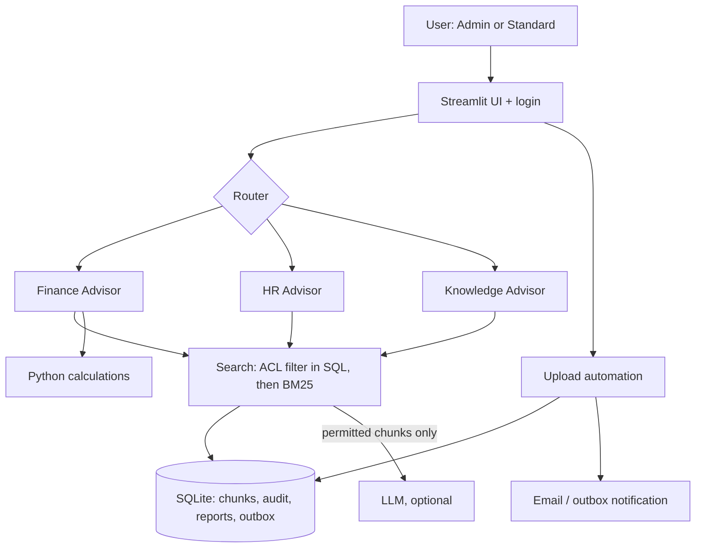

# Mini AI Executive Advisory System

Streamlit app: document Q&A with citations, Finance + HR advisors with auto-routing, role-based access control, upload automation, audit log.

## Run
```bash
python -m venv .venv
# Mac/Linux:  source .venv/bin/activate
# Windows:    .venv\Scripts\activate
pip install -r requirements.txt
python seed.py                      # loads synthetic sample docs (incl. conflicts + a confidential file)
# optional: set ANTHROPIC_API_KEY (Windows: set ANTHROPIC_API_KEY=...); without it the app uses extractive fallback answers
streamlit run app.py
```
Run `pytest -q` in a second terminal to execute the reliability tests.
Logins (demo only): `admin/admin123` (Administrator), `alice/user123` (Standard User).

**Note:** the LLM layer is optional. Without `ANTHROPIC_API_KEY`, the app runs in fallback mode: retrieval, access control, routing, conflict detection and financial calculations still work, and answers show the best matching passage. Setting the key enables written answers with citations.

## Architecture


**Security:** classification filtering happens in the database query *before* retrieval, so restricted text never enters the prompt. Standard users get the same "insufficient evidence" reply whether a document is absent or restricted (no existence leak). Only admins may upload confidential files. All asks, denials, failed logins and failures are audited.

## Reliability (tests/test_core.py)
Missing info, conflicting HR docs, conflicting finance figures, unauthorized retrieval (search, ask, upload), LLM outage fallback, finance math and `verify_figure` for incorrect figures, routing, automation.

## Deployment / operations
Docker container behind HTTPS reverse proxy (nginx/Caddy) with SSO (OIDC) replacing demo logins; secrets in env/secret manager; move SQLite to Postgres and BM25 to a vector DB (pgvector/Chroma) for scale; encrypt storage; ship audit table to central logging with alerts on `DENIED_*`/`llm_failure`; health check, backups, dependency scanning, rate limiting; expand with more advisors, OCR, Slack/Teams webhooks.

## Declaration
- AI tools used: Claude generated the initial scaffold (application code, tests, README, deployment notes) and helped diagnose issues during testing. I ran, tested and modified the result.
- What I did myself: set up and ran the system locally, tested the scenarios in the brief end to end, applied and verified fixes during testing (a UI bug where a success message appeared before an upload was processed, and a security gap that let a standard user overwrite a restricted document), configured Git and GitHub, and prepared the submission. I can explain and modify the code.
- External assistance: none beyond the AI tool
